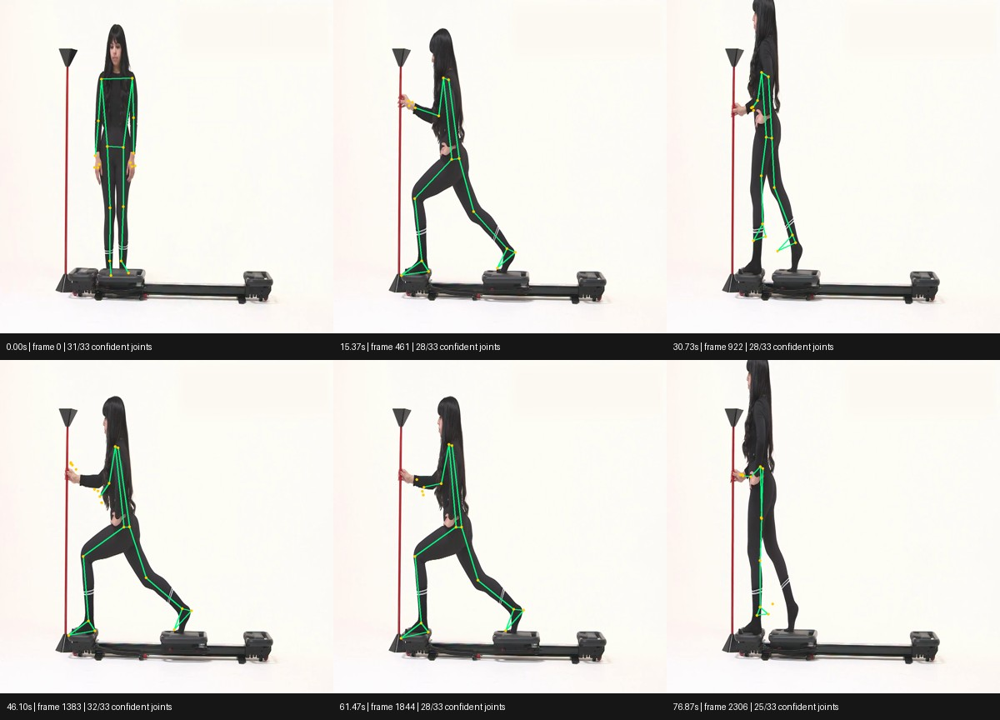

# Video → MediaPipe → ordered landmark data

This stage extracts pose measurements. It does not train a classifier or assign
frame-level ground truth. Raw videos live in `data/raw/`; extracted data lives in
`data/processed/landmarks/`. Neither raw videos nor bulk processing results are
committed to Git.

## Setup and run

Tested with Python 3.12 on Apple Silicon. Use a separate environment:

```sh
python3.12 -m venv .venv
.venv/bin/python -m pip install -r requirements-pose.lock.txt
mkdir -p models
curl -fL https://storage.googleapis.com/mediapipe-models/pose_landmarker/pose_landmarker_full/float16/1/pose_landmarker_full.task -o models/pose_landmarker_full.task
```

The full float16 v1 model used here has SHA-256
`5134a3aad27a58b93da0088d431f366da362b44e3ccfbe3462b3827a839011b1`.
The model is Google's pretrained **Pose Landmarker**, not a Pilates classifier.
The package versions are recorded in both the lock file and each run's summary.

```sh
# One local video, preserving all decoded frames at their source times:
.venv/bin/python tools/pose/extract.py data/raw/elevator_lunge.mp4

# All videos in data/raw/ and its subfolders:
.venv/bin/python tools/pose/extract.py

# Combine all completed sequences into one frame-level table:
.venv/bin/python tools/pose/combine.py

# Use a different input folder, with no catalog required:
.venv/bin/python tools/pose/extract.py --input-dir /path/to/videos

# Optional lower-rate extraction, still using actual source frame timestamps:
.venv/bin/python tools/pose/extract.py data/raw/elevator_lunge.mp4 --sample-fps 15 --output data/processed/landmarks-15fps

# Regenerate an existing output explicitly:
.venv/bin/python tools/pose/extract.py data/raw/elevator_lunge.mp4 --overwrite

.venv/bin/python -m unittest discover -s tests
```

No downloads are initiated by the extractor. By default it processes existing
videos, including any already downloaded file whose CSV selection later became 0.
The CSV selection controls the downloader, not the extractor. Discovery is
recursive and case-insensitive for `.mp4`, `.mov`, `.m4v`, `.mkv`, `.avi`, `.webm`.
Pass explicit video paths to choose an exact subset. A matching optional catalog
provides video IDs and candidate titles; other files use a filename plus a content
hash for identity. The pipeline can run with no catalog file at all.

Existing complete outputs are skipped only if source location/hash, model hash,
extractor hash, package versions, metadata, and settings match. Otherwise use
`--overwrite` to regenerate deliberately. A failure is reported per video, the
rest of the batch continues, and the command exits unsuccessfully if any failed.
Extraction fails on missing or non-increasing presentation timestamps rather than
silently inventing a clock.

## Output schema

Each video gets `data/processed/landmarks/<video_id>/`:

| File | Contents |
| --- | --- |
| `frames.csv` | One row per processed frame, in original chronological order |
| `sequence.npz` | The same ordered data in arrays suitable for feature engineering |
| `summary.json` | Provenance, parameters, detection/visibility rates, missing intervals |
| `preview.jpg` | Six frames spread across the video, with confident body landmarks drawn |

`python tools/pose/combine.py` writes `data/processed/landmarks.csv`: one combined
frame-level CSV containing all completed per-video outputs. It adds `video_name`
(the source filename), retaining `exercise_name`, `video_id`, frame indices,
timestamps, and all landmark columns. Rows are grouped by video and chronological
within each video; timestamps restart for each sequence. It preserves missing
values and verifies schemas, identities, frame counts, and order before replacing
the combined file. Rerun this command after extracting more videos. It includes
all completed outputs, regardless of the CSV download-selection flags.

This combined table is still an intermediate CSV. A final labeled training
CSV belongs in `data/processed/features/` once usable intervals, class labels,
and engineered features are agreed on. Temporal windows will belong in
`data/processed/windows/`. This stage does not merge all frames into a final
training dataset.

### Example preview



This sample contains 2,307 ordered frames. Pose detection returned landmarks on
all frames, while approximately 78% of body landmarks met the 0.5 visibility and
presence thresholds. These rates describe output coverage, not accuracy.

CSV identity/timing columns:

`video_id, exercise_name, frame_index, source_pts, timestamp_s,
mediapipe_timestamp_ms, pose_detected, confident_landmarks`

Then, for each of the standard 33 MediaPipe landmark names, five channels in each
of two spaces: `x, y, z, visibility, presence`. Examples:
`image_left_knee_x`, `image_left_knee_visibility`, `world_right_hip_z`.
There are 330 measurement columns and 8 metadata columns. These metadata columns
are for joins and auditing, **not classifier inputs**.

NPZ arrays (load with `np.load(path, allow_pickle=False)`):

| Key | Shape | Meaning |
| --- | --- | --- |
| `image_landmarks` | `(T, 33, 5)` | Image-space x/y normalized by image dimensions; relative z; visibility/presence |
| `world_landmarks` | `(T, 33, 5)` | Estimated metric x/y/z relative to hip midpoint; visibility/presence |
| `landmark_valid` | `(T, 33)` | Finite coordinates AND visibility/presence ≥ confidence threshold |
| `pose_detected` | `(T,)` | Whether a pose was returned for each processed frame |
| `timestamp_s` | `(T,)` | Actual video presentation times, seconds since first decoded frame |
| `frame_index` | `(T,)` | Zero-based index in the original decoded video |
| `source_pts` | `(T,)` | Original presentation timestamps; time base recorded in summary |
| `mediapipe_timestamp_ms` | `(T,)` | Strictly increasing integer clock passed to MediaPipe |
| `landmark_names`, `channels` | `(33,)`, `(5,)` | Axis definitions |
| `video_id`, `exercise_name` | scalar strings | Catalog metadata |

Missing detections remain in the sequence: coordinates/scores are NaN in NPZ,
empty in CSV, and masks are false. Low-confidence coordinates are retained but
masked. A zero coordinate is a legitimate value and is never a missing marker.
There is no interpolation or extra smoothing. VIDEO mode uses MediaPipe's own
temporal tracking; a fresh model is created for each video.

Source timestamps are preserved separately from rounded integer milliseconds.
If rounding would repeat an API timestamp, only the API clock advances by 1 ms.
Optional sampling keeps the first available source frame per requested time bin;
it does not interpolate frames or promise an exactly uniform sampling grid.

The summary includes source/model/extractor hashes, versions, native frame rate, processed
frame count, and quality statistics. Pose detection rate is **not pose accuracy**.
World coordinates are monocular model estimates, not measured motion capture.
The current extractor assumes one demonstrator; it does not establish identity
across multiple people or camera cuts. Videos with rotation metadata should be
visually checked; this pipeline processes the decoded pixel orientation.

## Before calling this a training dataset

1. Inspect `preview.jpg` and low-confidence intervals, especially wrists, hips,
   knees, and ankles occluded by the apparatus.
2. Annotate usable exercise intervals. Titles provide candidate video labels;
   setup, explanations, rest, transitions, and camera cuts are not automatically
   examples of the named exercise. Add an unknown/rest class where appropriate.
3. Agree on class mapping. For example, decide whether forward/reverse bear are
   different classes and whether the two plank-to-pike variants share one class.
   The CSV's overlapping group tags are not yet a single target class.
4. Keep people/videos together when splitting training/validation/test. Split
   **before** generating overlapping windows so adjacent frames from the same
   source cannot leak into multiple splits. Prefer subject-held-out evaluation
   once person identity is annotated.
5. Fit any scalers/imputers using training data only. Preserve missing masks;
   don't fill long gaps and pretend they are observed movement.

We currently have only one downloaded source video, despite nine selections.
That can validate extraction but cannot establish a multi-class recognition model
or generalization to unseen instructors/camera angles.

## Next: features and temporal windows

Keep these raw outputs immutable. Derive separate feature tables keyed by
`video_id, frame_index, timestamp_s`, so extraction need not be repeated:

- Elbow angle (shoulder–elbow–wrist), knee angle (hip–knee–ankle), hip angle
  (shoulder–hip–knee); use validity masks for all contributing landmarks.
- Hip-centered, body-scaled coordinates and selected joint distances.
- Angle/position changes divided by actual elapsed time, within continuous
  segments only; don't compute velocity across missing detections or camera cuts.

For 2D angles, convert normalized image x/y to pixel-proportional coordinates
first; using normalized x/y directly distorts angles on nonsquare frames.
For 3D angles, world-coordinate estimates avoid that aspect-ratio issue but still
need visual validation under occlusion and unfamiliar poses.

A bicep-curl counter is a useful small example: follow the elbow angle through
time and detect flexion/extension cycles with thresholds/hysteresis. Classifying
multiple Pilates movements needs additional joints, temporal context, and labeled
examples; elbow angle alone is not a general classifier.

For an SVM/MLP baseline, use frame features or statistics over short windows.
For LSTM/CNN-LSTM experiments, preserve `(windows, timesteps, features)` and masks.
Choose and document a common rate and window length after reviewing movement
speeds; don't shuffle frames before constructing sequences or windows.

## Relationship to the cited research

- [Kim et al. (2023), methods §2.1–2.2](https://link.springer.com/chapter/10.1007/978-3-031-43950-6_1):
  33 joints × x/y/z/visibility = 132 per-frame features, a fully connected network,
  manual labels including unknown, and a subject-level train/test split. This
  pipeline retains that representation plus presence and world coordinates.
- [Zhao, Lu & Guan (2024), author-institution abstract](https://scholars.hkbu.edu.hk/en/publications/classification-of-pilates-using-mediapipe-and-machine-learning/):
  MediaPipe skeletal keypoints and a CNN/LSTM approach across 370 videos of ten
  exercises. The abstract motivates temporal experiments; the full IEEE methods
  were not accessible here, so this is not presented as a reproduction.
- [Google Pose Landmarker documentation](https://developers.google.com/edge/mediapipe/solutions/vision/pose_landmarker?tab=Python):
  output definitions, VIDEO mode, confidence settings, and pretrained model source.
